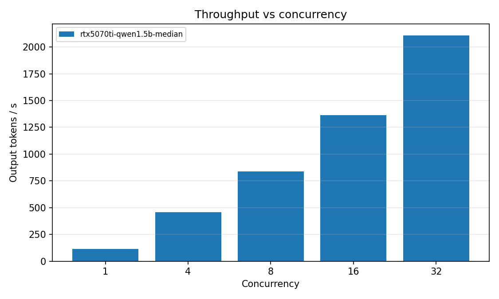

# llm-serving-stack

[](https://github.com/BOSS-Dominic/LLM-Serving-Stack/actions/workflows/ci.yml)
[](https://github.com/BOSS-Dominic/LLM-Serving-Stack)

> vLLM 推理服务部署 + 并发压测 + Go 多实例网关 + Prometheus/Grafana 全链路可观测

把「一个大模型怎么在线上跑得稳」拆成可验证的两层：**引擎层**（vLLM 的单机吞吐与延迟）和
**接入层**（多实例网关的负载均衡、故障摘除、流式透传）。所有数字都由仓库内脚本生成，
不存在手工抄写。

---

## 30 秒结论

| 维度 | 状态 | 证据 |
|---|---|---|
| Go 网关（健康检查 / 双策略负载均衡 / SSE / 重试 / 指标） | ✅ 已实现并测试 | `go vet` + `go test`（32 项，含并发、断连、超时、重试边界） |
| 压测工具（闭环保压、TTFT/TPOT/P99、容量基线） | ✅ 已实现并验证 | `pytest bench/tests`（14 项）+ mock 端到端 |
| 端到端联调（2 后端 / 故障摘除 / 指标） | ✅ 已实测 | 120 个流式请求 62/62 均分；杀掉一个后端后 2 次探测内摘除，请求 0 错误 |
| Prometheus + Grafana + 告警 | ✅ 配置已校验 | `promtool check config` 通过（7 条规则），dashboard JSON 18 个 panel（16 图 + 2 分组） |
| **vLLM 真实 GPU 压测**（RTX 5070 Ti Laptop 12 GB / Qwen2.5-1.5B） | ✅ **已实测** | 并发 1→32：吞吐 **114.6→2110 tok/s（18.4×）**，TTFT P99 **24→128 ms**，E2E P99 **≤0.807 s**，0 错误 |

> 诚实原则：**没有实测过的数字一个都不写**。每组配置独立跑 3 次取中位数，
> 原始数据、聚合脚本、图表都在仓库里；4090 / 7B 与 HF 基线仍是 ⏳ 待测，报告里明确标注。

### 实测结果（Qwen2.5-1.5B / 12 GB / vLLM 0.31.0，3 次中位数）

| 并发 | QPS | 输出 tok/s | TTFT P50 | TTFT P99 | E2E P99 | TPOT P50 |
|---:|---:|---:|---:|---:|---:|---:|
| 1 | 2.34 | 114.6 | 20 ms | 24 ms | 0.459 s | 8.3 ms |
| 4 | 9.67 | 457.2 | 33 ms | 44 ms | 0.537 s | 8.1 ms |
| 8 | 18.17 | 836.7 | 43 ms | 84 ms | 0.528 s | 8.2 ms |
| 16 | 29.11 | 1363.1 | 66 ms | 80 ms | 0.628 s | 8.9 ms |
| 32 | 44.60 | 2110.0 | 108 ms | 128 ms | 0.807 s | 10.9 ms |

> 32 并发时 KV Cache 已到 2048 上下文的上限（31.24 条序列），继续加并发只会排队。
> 这是 **12 GB 笔记本 GPU** 的数字，不是 4090；换卡后按 [报告 §4.2](docs/benchmark-report.md) 重跑同一条命令即可替换。



---

## 架构

```
                          ┌──────────────────────────────────────────┐
   client                 │            gateway (Go, :9000)           │
  (OpenAI SDK)            │                                          │
      │  /v1/chat/completions  ┌─────────────┐  ┌──────────────────┐ │
      ├──────────────────────▶ │  balancer   │  │ health checker    │ │
      │   stream: true         │ least_conn/ │  │ 10s probe, 2 次   │ │
      │                        │ round_robin │  │ 失败摘除/2 次恢复 │ │
      │                        └──────┬──────┘  └────────┬─────────┘ │
      │                               │                  │           │
      │                        ┌──────▼──────────────────▼─────────┐ │
      │                        │ proxy: 缓冲 body、首字节前重试、   │ │
      │                        │ SSE 逐块 flush、ctx 感知断连       │ │
      │                        └──────┬───────────────────┬─────────┘ │
      └───────────────────────────────┘                   │           │
                                                          │           │
                    ┌─────────────────────────────────────┴──────┐    │
                    │                                            │    │
              ┌─────▼──────┐                              ┌──────▼──┐ │
              │ vllm-1     │   PagedAttention             │ vllm-2  │ │
              │ :8000      │   continuous batching        │ :8000   │ │
              └─────┬──────┘                              └────┬────┘ │
                    └──────────────┬───────────────────────────┘      │
                                   │ /metrics                          │
                          ┌────────▼─────────┐   ┌──────────────────┐  │
                          │  Prometheus      │──▶│  Grafana         │  │
                          │  :9090           │   │  :3000           │  │
                          └──────────────────┘   └──────────────────┘  │
                                                                       │
                          └───────────────────────────────────────────┘
```

请求生命周期（引擎层，面试要能默画）：

```
Client → OpenAI API → Scheduler（等待队列/准入）
       → 每 iteration 组 batch（continuous batching）
       → prefill（计算密集）→ decode（访存密集，逐 token）
       → KV blocks 按需分配/回收（PagedAttention，16 token/block）
       → 流式返回，结束释放 block
```

---

## 目录结构

```
llm-serving-stack/
├── README.md                     # 本文件：架构 + 一页结论
├── docs/
│   ├── benchmark-report.md       # 压测报告（方法、结果、容量基线）
│   └── decisions.md              # 技术取舍清单（为什么不是另一个方案）
├── bench/
│   ├── bench_pro.py              # 闭环保压脚本（TTFT/TPOT/P50/P95/P99/QPS）
│   ├── mock_vllm.py              # 无 GPU 时可用的假 vLLM（CI / 联调用）
│   ├── summarize.py              # JSON → Markdown 表格 + 容量基线
│   ├── aggregate.py              # 多次运行 → 中位数 + 波动（min/median/max）
│   ├── plot.py                   # JSON → 吞吐/延迟曲线图
│   ├── requirements.txt
│   ├── results/                  # 压测 JSON（报告的唯一数据源；repeats/ 存原始三次运行）
│   └── tests/                    # 14 项测试（统计口径 + 端到端）
├── gateway/
│   ├── main.go / config.go       # 入口、配置、优雅退出
│   ├── backend.go                # Backend、Pool、健康检查
│   ├── balancer.go               # 最少连接 / 平滑加权轮询
│   ├── proxy.go                  # 转发、SSE、重试、超时
│   ├── metrics.go                # Prometheus 指标
│   ├── *_test.go                 # 并发/重试/流式/断连测试
│   ├── config.yaml
│   └── Dockerfile
├── deploy/
│   ├── docker-compose.yml        # vllm / gateway / prometheus / grafana
│   ├── prometheus/               # 抓取配置 + 7 条告警规则
│   └── grafana/                  # 数据源、看板 provider、dashboard JSON
└── .github/workflows/ci.yml      # Go 测试 + Python 测试 + 配置校验
```

---

## 快速开始

### 0. 前置

- Go 1.26+（网关；`prometheus/client_golang` 最新版要求 1.26）、Python 3.10+（压测）
- 想跑真实 vLLM：Linux + NVIDIA GPU（vLLM 不支持 Windows 原生运行）+ Docker

### 1. 无 GPU：先把网关和压测链路跑通（2 分钟）

```bash
# 起两个假 vLLM 后端
python bench/mock_vllm.py --port 18001 --token-ms 2 &
python bench/mock_vllm.py --port 18002 --token-ms 2 &

# 编译并起网关（用环境变量覆盖后端列表；括号保证不改变当前目录）
(cd gateway && go build -o gateway .)
(cd gateway && GATEWAY_BACKENDS="m1=http://127.0.0.1:18001,m2=http://127.0.0.1:18002" ./gateway -config config.yaml) &

# 压测（走网关）
python bench/bench_pro.py \
  --base-url http://127.0.0.1:9000 --model mock-qwen \
  --concurrency 1,4,8 --num-requests 40 --max-tokens 32

# 杀一个后端，观察摘除
curl -s localhost:9000/debug/backends
```

> **Windows PowerShell 等价写法**（三个终端）：
>
> ```powershell
> # 终端 1、2：各起一个 mock
> python bench\mock_vllm.py --port 18001 --token-ms 2
> python bench\mock_vllm.py --port 18002 --token-ms 2
>
> # 终端 3：网关
> $env:GATEWAY_BACKENDS = "m1=http://127.0.0.1:18001,m2=http://127.0.0.1:18002"
> cd gateway; go build -o gateway.exe .; .\gateway.exe -config config.yaml
> ```
>
> 然后另开终端跑压测：`python bench\bench_pro.py --base-url http://127.0.0.1:9000 --model mock-qwen --concurrency 1,4,8 --num-requests 40 --max-tokens 32`

### 2. 有 GPU：起真实 vLLM + 监控栈

```bash
cd deploy
cp .env.example .env          # 填模型名；国内网络建议 HF_ENDPOINT=https://hf-mirror.com
docker compose --profile gpu up -d
docker compose logs -f vllm   # 等模型加载完成（首次要下载权重）
```

然后：

```bash
# 压测必须和 vLLM 跑在同一台机器上（否则测的是网线，不是 GPU）
python bench/bench_pro.py \
  --base-url http://127.0.0.1:8000 \
  --model qwen \
  --concurrency 1,4,16,32 \
  --num-requests 100 \
  --max-tokens 128 \
  --label rtx4090-qwen7b \
  --same-host

# 生成报告表格
python bench/summarize.py --out docs/generated/benchmark-tables.md
```

Grafana：<http://localhost:3000>（admin/admin）→ 预置看板 **LLM Serving Stack**。

### 3. 只跑监控（不跑 GPU）

```bash
cd deploy
BACKENDS=mock-1=http://mock-vllm:18000 docker compose --profile mock up -d --build
```

---

## 压测方法（为什么数字可信）

| 控制变量 | 做法 | 不这么做会怎样 |
|---|---|---|
| 闭环保压 | 固定并发、完成一个补一个 | `gather(N)` 测的是"一批排干速度"，QPS 虚高、延迟偏低 |
| 固定输出长度 | `max_tokens=128`，`temperature=0` | 输出长度不同，tok/s 没有可比性 |
| 同机压测 | 客户端与 vLLM 同机（`--same-host`） | 测的是家用宽带 |
| 预热 | 丢弃前 4 个请求 | 首批请求在编译 kernel / 加载权重 |
| 档位间隔 | 每档间隔 2s | 上一档的 KV Cache 影响下一档 |
| 正确分位数 | 线性插值（`numpy.percentile` 同口径） | `sorted()[int(n*0.95)-1]` 在 n=4 时是 P75 |
| 错误不重试 | 客户端 `max_retries=0`，错误计入 error_rate | 重试会悄悄污染 P99 |
| 关系统代理 | 客户端 `trust_env=False` | 本机实测遇到过 Privoxy 劫持 `127.0.0.1`，TTFT 全是代理的 |

指标定义：

- **TTFT**：提交 → 第一个流式 chunk。受排队 + prefill 影响。
- **TPOT**：`(E2E - TTFT) / (completion_tokens - 1)`。decode 速度。
- **E2E**：提交 → 最后一个 chunk。
- **QPS / tok/s**：以测量窗口（首请求提交 → 末请求完成）为分母。

---

## 关键设计（细节见 [docs/decisions.md](docs/decisions.md)）

1. **选择与计数在同一把锁内**：`least_conn` 的"读 Running → 选最小 → Running++"如果分开做，
   高并发下会退化成"全打一台"。200 goroutine 并发测试验证分布。
2. **平局用累计请求数打破**：严格 `<` 比较时，两个空闲实例永远平局、永远选第一个。
   端到端实测曾出现 **83:41** 的偏斜，修复后 62:62。这条是真实踩坑记录。
3. **流式响应读到第一个 chunk 才提交响应头**：后端在 prefill 阶段挂掉时，客户端还没收到任何字节，
   网关可以安全地换实例重试；否则只能把半截流返回给用户。
4. **首字节之后绝不重试**：客户端已收到 token，换后端会重复或断裂。
5. **超时分离**：流式用首字节超时（30s），非流式用总超时（60s），`http.Client.Timeout` 恒为 0。
   一个全局 60s 超时会掐断所有正常的长生成。
6. **健康探针不复用连接**：keep-alive 探针会在实例停止 accept 新连接后继续报健康。
7. **探针软摘除**：只影响新请求的选择，在途请求跑完。

---

## 可观测性

网关暴露（`/metrics`）：

| 指标 | 类型 | 用途 |
|---|---|---|
| `gateway_requests_total{backend,code,stream}` | Counter | 分后端/状态码/是否流式的请求量 |
| `gateway_request_duration_seconds{backend,stream}` | Histogram | 端到端延迟 |
| `gateway_ttft_seconds{backend}` | Histogram | 客户端视角首字节延迟 |
| `gateway_backend_running_requests{backend}` | Gauge | 每实例在途请求（≈ 负载分布） |
| `gateway_backend_healthy{backend}` | Gauge | 是否在轮转中 |
| `gateway_retries_total{backend}` | Counter | 重试次数 |
| `gateway_inflight_requests` | Gauge | 网关整体并发 |

引擎侧直接抓 vLLM 原生指标：`vllm:num_requests_running`、`vllm:num_requests_waiting`、
`vllm:gpu_cache_usage_perc`、`vllm:time_to_first_token_seconds_bucket` 等。

告警规则（`deploy/prometheus/alerts.yml`）：后端宕机、TTFT P95 超 5s、等待队列 > 10、
KV Cache > 95%、网关无健康后端、5xx 比例 > 5%、重试风暴。

---

## 验证方式

```bash
# 网关
cd gateway && gofmt -l . && go vet ./... && go test -race -count=1 ./...

# 压测工具
python -m pytest bench/tests -q

# 部署配置
docker compose -f deploy/docker-compose.yml config -q
docker run --rm --entrypoint promtool \
  -v "$PWD/deploy/prometheus:/etc/prometheus:ro" \
  prom/prometheus:latest check config /etc/prometheus/prometheus.yml
```

CI（GitHub Actions）跑同样的四组检查，见 `.github/workflows/ci.yml`。

---

## 已知限制

- **4090 / 7B 与 HF 基线未测**：本报告数字来自 RTX 5070 Ti Laptop（12 GB）+ Qwen2.5-1.5B，
  绝对吞吐会低于 4090；测量方法已固化，换卡重跑同一条命令即可替换。
- 压测在笔记本 GPU 上做，run-to-run 波动 5–20%（报告里给了 min/median/max）；服务器卡会稳得多。
- 后端列表不支持热加载，改配置需重启（重启会重新探测健康状态，几秒内恢复）。
- 限流是进程级全局令牌桶，不是按租户/按模型。
- 未做 prefill/decode 分离、按 KV Cache 利用率路由（属于 vLLM Router 的方向）。
- TP=1 vs TP=2 未做，原因与取舍见 decisions.md。

---

## 面试口径（背这段）

> "我做了两层：引擎层用 vLLM 部署 OpenAI 兼容服务，用闭环保压量化 TTFT、TPOT、P99 和吞吐，
> 并压出容量基线——在 12 GB 卡 + 1.5B 上，并发 1→32 吞吐从 114 涨到 2110 tok/s，
> TTFT P99 从 24 ms 涨到 128 ms，32 并发时 KV Cache 到达上限、瓶颈从算力转成显存。
> 接入层用 Go 写了一个多实例网关，做健康检查与软摘除、最少连接负载均衡、
> SSE 逐块透传，以及只在首字节之前发生的重试。踩过的坑里最能讲的是三个：
> 最少连接在平局时会全打第一台（实测 83:41）、流式响应如果先提交响应头就没法重试、
> 以及压测时如果后台有游戏占 GPU，吞吐会直接腰斩——所以每组数据都跑 3 次取中位数。"

---

## License

MIT
