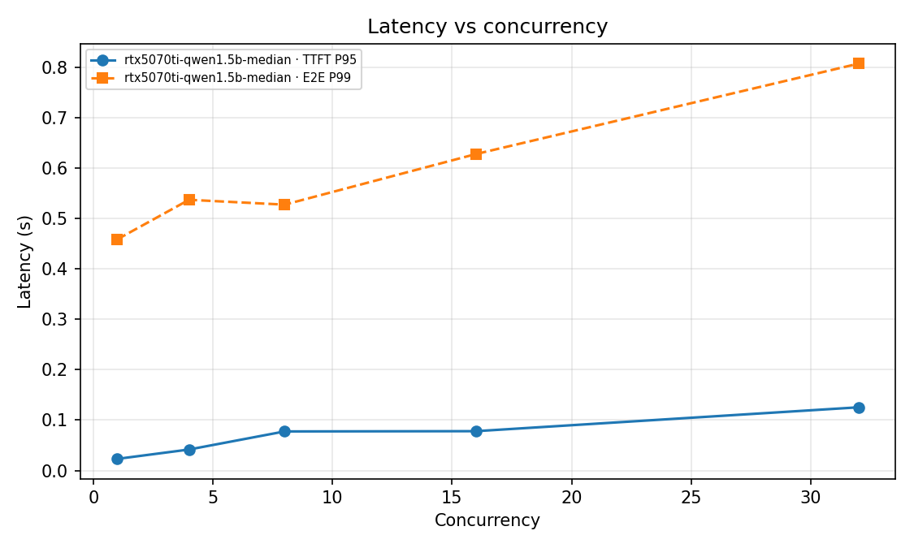

# vLLM 推理服务压测报告

> 项目：LLM 推理服务工程化实践（性能基准 + 多实例网关）
> 本文件中的每个数字都来自 `bench/results/*.json`，表格由 `bench/summarize.py` 生成。
> **未实测的格子写"—"，不写估计值。**

---

## 0. 当前状态

| 内容 | 状态 | 位置 |
|---|---|---|
| 压测工具链（闭环保压、TTFT/TPOT/P99、容量基线推导） | ✅ 已实现并验证 | `bench/bench_pro.py`、`bench/summarize.py`、`bench/aggregate.py` |
| 网关端到端（2 后端、故障摘除、指标） | ✅ 已实测 | 本文件 §3 |
| 网关引入的额外延迟（同后端 direct vs proxied） | ✅ 已实测 | 本文件 §3.2 |
| 真实 vLLM 引擎压测（并发 1/4/8/16/32） | ✅ **已实测**（RTX 5070 Ti Laptop 12 GB） | 本文件 §4 |
| vLLM vs HuggingFace 基线 | ⏳ 待实测 | 本文件 §5 |
| TP=1 vs TP=2 | ⛔ 主动砍掉 | 本文件 §6 |
| 容量基线表 | ✅ **已填**（3 次运行取中位数） | 本文件 §7 |

**实测环境说明**：§4/§7 的数字在 Windows + **RTX 5070 Ti Laptop（12 GB，sm_120）** 上测得：
vLLM 0.31.0、torch 2.13.0+cu130、CUDA 13.0、Qwen2.5-1.5B-Instruct（FP16）。
**这不是 AutoDL 4090**：绝对吞吐会低于 4090，但测量方法、容量推导和结论形态可以直接复用；
换到 4090 后按 §4.2 的同一条命令重跑即可替换本报告的数字。

过程中绕过了两个真实环境问题：Docker daemon 拉取镜像被网络阻断（改用本机已有镜像 +
容器内 `pip install vllm` + ModelScope 下载模型），以及 FlashInfer 采样器需要 `nvcc` 现场编译
（镜像只有 CUDA runtime，关闭 FlashInfer 采样）。细节见 `decisions.md` B7/B8。

**关于重复性与干扰**：每组配置独立跑 3 次，报告使用**中位数**（`bench/aggregate.py`），
并在 §4.3 给出 min/median/max 波动。第一次扫描时有游戏占用 GPU，吞吐只有干净环境的约一半，
那批数据已全部丢弃——这也说明压测前必须确认 GPU 空闲（`nvidia-smi`，见 decisions.md B7）。

**§3 的数字是什么**：用的是 `bench/mock_vllm.py`（按固定 prefill/per-token 延迟返回
OpenAI 兼容响应的假引擎）。它验证的是**测量工具与网关链路是否正确**，不是模型性能。
标签与模型名都带 `mock`，`summarize.py` 默认会把它们过滤掉，避免混进简历数字。

---

## 1. 实验环境

### 1.1 实测环境（§4 / §7 的数字来自这里）

| 项 | 值 |
|---|---|
| GPU | NVIDIA RTX 5070 Ti Laptop，12 GB，sm_120（**不是 4090**） |
| CPU / 内存 | Intel Core i9-13900HX / 31.7 GB |
| 模型 | Qwen2.5-1.5B-Instruct（FP16，safetensors 2.88 GiB） |
| vLLM | 0.31.0 |
| PyTorch / CUDA | 2.13.0+cu130 / CUDA 13.0 |
| 驱动 | 610.47 |
| 容器 | Ubuntu 22.04 + CUDA runtime（无 nvcc） |
| 客户端 | 与 vLLM 同机，openai 2.29.0 |
| 启动参数 | `--gpu-memory-utilization 0.45 --max-model-len 2048 --max-num-seqs 32 --no-enable-log-requests --disable-log-stats` |
| KV Cache | 63,984 tokens；2048 上下文下最大并发 31.24 |
| 备注 | 桌面程序占用约 5.2 GB 显存，因此只给 vLLM 0.45 的显存比例 |

> 4090 复测：把模型换成 7B，`--gpu-memory-utilization 0.9 --max-model-len 4096`，其余命令不变。

### 1.2 工具链验证环境（§3 的数字来自这里）

| 项 | 值 |
|---|---|
| CPU | Intel Core i9-13900HX |
| 内存 | 31.7 GB |
| GPU | NVIDIA RTX 5070 Ti Laptop，12 GB（**未参与** §3 的压测） |
| OS | Windows（Go 1.27.3 / Python 3.10.11） |
| 引擎 | `bench/mock_vllm.py`（Python 标准库，ThreadingHTTPServer） |
| 网关 | 本仓库 `gateway/`（Go，least_conn，2 后端） |
| 压测客户端 | `bench_pro.py`，openai 2.29.0 / httpx 0.28.1 |
| 网络 | 本机 loopback |

---

## 2. 压测方法

### 2.1 闭环压测（closed loop）

维持恰好 `C` 个在途请求：任何一个完成，立刻补一个新的，直到完成 `N` 个请求。
测量窗口为**首个请求提交 → 最后一个请求完成**。

```
QPS        = N_ok / wall
tok/s      = Σ completion_tokens / wall
TTFT       = t_first_chunk - t_submit
TPOT       = (t_last_chunk - t_first_chunk) / (completion_tokens - 1)
E2E        = t_last_chunk - t_submit
```

为什么不写成 `asyncio.gather(N)`：那只测了"一批请求排干的速度"，没有持续负载与排队效应，
QPS 偏高、P99 偏低，且不同并发档位之间不可比。

### 2.2 控制变量

| 变量 | 设置 | 原因 |
|---|---|---|
| 输出长度 | `max_tokens=128` | 输出长度不同，tok/s 无可比性 |
| 采样 | `temperature=0` | 避免随机停止导致长度漂移 |
| 每档请求数 | 100（≥50） | 分位数在 n<50 时不可信 |
| 预热 | 4 个请求，丢弃 | 首批请求在编译 kernel / 加载权重 |
| 档位间隔 | 2 s | 让上一档的 KV Cache / 队列排空 |
| 客户端位置 | 与引擎同机 | 否则测的是网络 |
| 客户端重试 | `max_retries=0` | 重试会污染延迟分布 |
| 客户端代理 | `trust_env=False` | 本机实测系统代理会劫持 `127.0.0.1`（见 decisions B3） |
| 服务日志 | `--disable-log-requests` | 日志 IO 会吃吞吐 |
| 服务状态 | 每轮实验前重启 | 避免 KV Cache / prefix cache 预热干扰 |

### 2.3 分位数口径

线性插值：`k=(n-1)p`，在 `⌊k⌋` 与 `⌈k⌉` 之间插值（与 `numpy.percentile` 一致）。
常见的 `sorted(xs)[int(n*0.95)-1]` 在 n=4 时取到索引 2，实际是 P75——本项目有单元测试专门盯这一点。

### 2.4 和官方 benchmark 的关系

`vllm bench serve`（新版本）与 `benchmarks/benchmark_serving.py`（旧入口）能快速出数，
但它们的并发模型和统计口径与本脚本不同。本项目以 `bench_pro.py` 为准，
官方工具用于交叉验证趋势（两者都显示"并发升高、吞吐趋平、TTFT 上升"即可）。

### 2.5 数据可信性的威胁（必须知道）

| 威胁 | 影响 | 处理 |
|---|---|---|
| mock 引擎的延迟是 `time.sleep` | **Windows 定时器粒度 15.5 ms**，把设计的 2 ms/token 放大成 16 ms | §3 的 TPOT 只能看趋势，不能当模型性能；真实 GPU 上不存在 |
| loopback + Python mock | 网关开销被低估/噪声放大 | §3.2 只用于判断"网关没有引入数量级开销" |
| Python GIL + 线程 mock | 高并发下 mock 自身先饱和 | 并发档位最多到 8；真实引擎用 16/32 |
| 共享 GPU（笔记本） | 真实 GPU 数字会受其他进程影响 | 未用于任何结论；AutoDL 独占实例 |
| 系统代理 / VPN | 静默污染延迟 | 客户端强制 `trust_env=False` |

---

## 3. 工具链验证（已实测，mock 引擎）

### 3.1 双后端 + 网关端到端

拓扑：`bench_pro → gateway(:19000) → mock-1 / mock-2`，每个 mock 设 `prefill=10ms`、`token=2ms`（实际约 16 ms/token）。
每档 40 请求，标签 `e2e-gateway-mock`。

| 并发 | 完成/总数 | QPS | 输出 tok/s | TTFT P50 (s) | TTFT P95 (s) | TTFT P99 (s) | E2E P50 (s) | E2E P99 (s) | TPOT P50 (ms) | 错误率 |
|---:|---:|---:|---:|---:|---:|---:|---:|---:|---:|---:|
| 1 | 40/40 | 1.91 | 61.0 | 0.031 | 0.033 | 0.033 | 0.525 | 0.530 | 15.9 | 0.0% |
| 4 | 40/40 | 7.59 | 242.9 | 0.028 | 0.036 | 0.041 | 0.524 | 0.537 | 16.0 | 0.0% |
| 8 | 40/40 | 14.74 | 471.7 | 0.039 | 0.052 | 0.053 | 0.538 | 0.551 | 16.1 | 0.0% |

**能得到的结论**（只限工具链）：

1. 并发 1→8，QPS 从 1.91 涨到 14.74（约 7.7×），**吞吐随并发近似线性增长**——
   说明压测确实是并发在跑，而不是排干一批。
2. TTFT P99 从 33 ms 涨到 53 ms，**延迟随负载上升**，符合排队预期。
3. 两个后端各承接 62 个流式请求（62:62），**least_conn 在混合并发下是均衡的**。
4. 0 错误、0 重试。

**不能得到的结论**：这些数字不是 vLLM 的性能。mock 没有 KV Cache、没有 batching、TPOT 被 OS 定时器主导。

### 3.2 网关额外开销（同一后端，direct vs proxied）

同一个 mock 后端（`prefill=10ms`，`token=2ms`），先直连、再经网关，各跑一遍相同参数。

| 并发 | 直连 QPS | 网关 QPS | 直连 TTFT P50 | 网关 TTFT P50 | 直连 E2E P99 | 网关 E2E P99 |
|---:|---:|---:|---:|---:|---:|---:|
| 1 | 1.92 | 1.91 | 0.029 | 0.030 | 0.530 | 0.529 |
| 4 | 7.56 | 7.50 | 0.029 | 0.028 | 0.536 | 0.555 |
| 8 | 14.56 | 14.60 | 0.040 | 0.041 | 0.560 | 0.592 |

**结论**：在本机 loopback 上，网关对 **TTFT P50 的影响 < 2 ms**，QPS 差异在 ±1% 以内（噪声量级），
**P99 尾部增加约 3–8 ms**（多发一跳 + Go GC 抖动）。相对真实模型 500 ms+ 的 E2E，这个开销可以忽略。
注意：真实部署中网关与 vLLM 可能跨机，网络跳数会增加，需按实际拓扑重测。

### 3.3 故障摘除

运行中停止 `mock-2` 后：

| 观测点 | 结果 |
|---|---|
| 探测失败次数 | 2（达到 `unhealthy_after=2`） |
| `/debug/backends` 中 `mock-2.healthy` | `false` |
| `gateway_backend_healthy{backend="mock-2"}` | `0` |
| 摘除后请求 | HTTP 200，`X-Gateway-Backend: mock-1`，0 错误 |

这验证了"软摘除"：健康检查只停止新请求的选择，在途请求不受影响。

---

## 4. 引擎层压测（✅ 已实测：RTX 5070 Ti Laptop + Qwen2.5-1.5B）

### 4.1 实验矩阵

| 实验 | 变量 | 固定 |
|---|---|---|
| 并发扫描 | `--concurrency 1,4,8,16,32` | 输入约 200 token、输出 128、N=100、`temperature=0`、同机 |
| 重复性 | 每组配置独立跑 3 次，取中位数 | 笔记本 GPU 的时钟/温度波动 5–20% |
| 对照（待做） | vLLM vs HF Transformers | 同一组 prompt、同一 `max_tokens` |

### 4.2 执行命令

```bash
# 本次实测（1.5B / 12 GB 卡）：镜像没有 nvcc，必须关掉 FlashInfer 采样
VLLM_USE_FLASHINFER_SAMPLER=0 python3 -m vllm.entrypoints.openai.api_server \
  --model /models/qwen1.5b --served-model-name qwen-1.5b \
  --gpu-memory-utilization 0.45 --max-model-len 2048 --max-num-seqs 32 \
  --no-enable-log-requests --disable-log-stats

# 同机压测（5 档并发，每档 100 请求）
python bench/bench_pro.py \
  --base-url http://127.0.0.1:8000 \
  --model qwen-1.5b \
  --concurrency 1,4,8,16,32 \
  --num-requests 100 \
  --max-tokens 128 \
  --prompt-chars 400 \
  --warmup 8 \
  --label rtx5070ti-qwen1.5b \
  --same-host

# 跑 3 次后取中位数（bench/results/repeats/ 下是三次独立运行）
python bench/aggregate.py \
  --pattern "bench/results/repeats/rtx5070ti-*.json" \
  --label rtx5070ti-qwen1.5b-median \
  --out bench/results/rtx5070ti-qwen1.5b-median.json
```

> 压测前先 `curl localhost:8000/health` 确认 `Application startup complete`；
> **确认 GPU 空闲**（`nvidia-smi` 没有游戏/渲染进程）。本次最初一轮就是在有游戏占用时跑的，
> 吞吐只有干净环境的一半，已整批丢弃。

### 4.3 结果（3 次独立运行的逐档中位数）

| 并发 | QPS | 输出 tok/s | 总 tok/s | TTFT P50 (s) | TTFT P95 (s) | TTFT P99 (s) | E2E P50 (s) | E2E P99 (s) | TPOT P50 (ms) | 错误率 |
|---:|---:|---:|---:|---:|---:|---:|---:|---:|---:|---:|
| 1 | 2.34 | 114.6 | 730.0 | 0.020 | 0.023 | 0.024 | 0.421 | 0.459 | 8.3 | 0.0% |
| 4 | 9.67 | 457.2 | 3000.8 | 0.033 | 0.042 | 0.044 | 0.405 | 0.537 | 8.1 | 0.0% |
| 8 | 18.17 | 836.7 | 5625.0 | 0.043 | 0.077 | 0.084 | 0.407 | 0.528 | 8.2 | 0.0% |
| 16 | 29.11 | 1363.1 | 9020.2 | 0.066 | 0.078 | 0.080 | 0.496 | 0.628 | 8.9 | 0.0% |
| 32 | 44.60 | 2110.0 | 13801.0 | 0.108 | 0.125 | 0.128 | 0.600 | 0.807 | 10.9 | 0.0% |

每档 100/100 成功，0 错误、0 重试。

**重复性**（三次独立运行）：

| 并发 | QPS (min/median/max) | 输出 tok/s (min/median/max) | tok/s 波动 | TTFT P99 波动 | E2E P99 波动 |
|---:|---|---|---:|---:|---:|
| 1 | 2.30 / 2.34 / 2.43 | 113 / 115 / 119 | 5.6% | 6.6% | 18.8% |
| 4 | 9.46 / 9.67 / 9.89 | 447 / 457 / 469 | 4.8% | 18.8% | 8.6% |
| 8 | 14.68 / 18.17 / 18.42 | 680 / 837 / 845 | 19.7% | 15.9% | 45.6% |
| 16 | 26.78 / 29.11 / 29.90 | 1354 / 1363 / 1441 | 6.4% | 12.3% | 22.7% |
| 32 | 41.06 / 44.60 / 46.10 | 2070 / 2110 / 2303 | 11.0% | 8.9% | 31.3% |

> 中位数与原始数据都在 `bench/results/`：`rtx5070ti-qwen1.5b-median.json` 是聚合结果，
> `repeats/` 下是三次独立运行。C=8 的 19.7% 波动是笔记本 GPU 上最明显的一档，
> 报告取中位数而不是最大值，避免把运气当性能。




### 4.4 实测结论（对照 4.1 的假设）

- **吞吐随并发近似线性上升，32 并发前没有明显趋平**：输出吞吐 114.6 → 2110 tok/s（18.4×），
  QPS 2.34 → 44.6（19×）。TPOT 稳定在 8–11 ms，说明连续批处理把 decode 阶段填得很满，
  单条流的速度几乎没有被同批请求拖慢。
- **TTFT 上升但仍然很低**：P50 从 20 ms 涨到 108 ms，P99 从 24 ms 涨到 128 ms——远低于 1 s 的 SLO。
  这是 1.5B 小模型的特征；7B 上 prefill 会明显更重。
- **E2E P99 始终 < 0.81 s**：即使 32 并发，端到端尾部也远低于 5 s。
- **32 并发已经顶到 KV Cache 边界**：`--max-model-len 2048` 下 KV Cache 只够 31.24 条并发序列，
  32 时已有请求排队。继续提高并发不会线性涨吞吐，会先表现在 `num_requests_waiting` 和 TTFT 上。
- **和"P99 比 P50 更早恶化"一致**：C=32 时 E2E P99/P50 = 0.807/0.600 ≈ 1.35，尾部在拉长。

---

## 5. vLLM vs HuggingFace Transformers（⏳ 待实测）

### 5.1 方法

- vLLM **没有"关闭 PagedAttention"的开关**，正确基线是 HF 原生 `model.generate()`。
- 两者使用同一组 prompt、同一 `max_tokens`、同一精度（FP16）。
- HF 侧按 batch 逐批生成，batch size 与 vLLM 的并发档位对齐。
- 指标：输出 tok/s（吞吐）与单请求 E2E P50（延迟）。

### 5.2 结果（待填）

| 并发/批量 | vLLM tok/s | HF tok/s | 倍数 | 备注 |
|---:|---:|---:|---:|---|
| 1 | — | — | — | |
| 4 | — | — | — | |
| 16 | — | — | — | |

### 5.3 注意

- `--enforce-eager` 对比的是 **CUDA Graph**，不是 PagedAttention，别混为一谈。
- 公开资料常引用"高并发下快 14–24 倍"，**以自己实测为准**；不同模型/长度差异很大。
- HF 基线在高并发下会 OOM，这是结论的一部分（显存利用率），不是失败。

---

## 6. TP=1 vs TP=2：未做，原因如下

- 7B 在 24 GB 单卡上放得下，TP=2 的跨卡 AllReduce 通信开销大概率大于切分收益，
  预期结论是"没有更快"——这个结论对面试的说服力很低。
- 需要双倍租金（2×4090），而同样的预算用于 HF 基线对比能产出更有价值的倍数结论。
- 如果目标岗位明确做多卡推理/国产算力，再补这一节；届时应记录：
  `--tensor-parallel-size 2` 下的 tok/s、TTFT，以及是否出现通信瓶颈。

---

## 7. 容量基线（✅ 已实测，这是 SRE 视角的核心产出）

### 7.1 实测结果

| 约束（可接受上限） | 最大可持续并发 | 对应吞吐 (tok/s) | TTFT P99 (s) | E2E P99 (s) | 瓶颈在哪 |
|---|---:|---:|---:|---:|---|
| TTFT P99 < 1 s | 32 | 2110.0 | 0.128 | 0.807 | 未触顶；KV Cache 上限 31.24 @2048，32 已到边界 |
| TTFT P99 < 1 s 且 E2E P99 < 5 s | 32 | 2110.0 | 0.128 | 0.807 | 同上 |
| 吞吐优先，不看延迟 | 32 | 2110.0 | 0.128 | 0.807 | KV Cache / 显存（12 GB，0.45 利用率） |

> 32 是本次测试的最高档位，也正好是 `--max-model-len 2048` 下 KV Cache 能容纳的并发上限（31.24）。
> 所以结论是"在已测范围内，TTFT P99 < 1 s 的容量至少是 32 并发 / 44.6 QPS / 2110 tok/s"，
> 而不是"32 是理论上限"——要继续提高，必须降 `max-model-len`、加显存或加副本。

### 7.2 这张表怎么来的

`bench/summarize.py` 对每个约束取"仍然满足条件的最大并发档位"；
输入是 1/4/8/16/32 五档、3 次独立运行的中位数（`bench/aggregate.py` 生成）。

### 7.3 怎么把它变成"需要几张卡"

假设业务目标：峰值 100 QPS、TTFT P99 < 1 s、E2E P99 < 5 s。

1. 单实例在 TTFT P99 < 1 s 下能扛 **44.6 QPS**（32 并发，1.5B / 12 GB）。
2. 副本数 = `ceil(100 / 44.6) = 3`，再留 1 个冗余应对故障/发布 → **4 个实例**。
3. 用 `vllm:gpu_cache_usage_perc` 复核：32 并发时 KV Cache 已到 31.24 的上限，
   说明瓶颈是显存而不是算力；此时应优先降 `--max-model-len` / `--max-num-seqs`，
   或换更大显存的卡，而不是继续加并发。

**这就是"输出容量基线"的含义**：不是"能扛 32 并发"，而是
"在 TTFT P99 < 1 s 的约束下，单卡（12 GB / 1.5B）能扛 32 并发 / 44.6 QPS / 2110 tok/s，
瓶颈是 KV Cache；按目标 100 QPS 反推需要 3 张卡 + 1 张冗余"。

> 换 7B / 4090 时这些数字都会变，但**推导方法不变**：跑 §4.2，再跑 `summarize.py` 即可。

---

## 8. 可观测性

### 8.1 看板

`deploy/grafana/dashboards/llm-serving.json`，18 个 panel（16 张图 + 2 个分组行），两层联动：

| 组 | 面板 | PromQL 要点 |
|---|---|---|
| Engine | Requests running / waiting | `sum(vllm:num_requests_running)`、`sum(vllm:num_requests_waiting)` |
| Engine | KV cache used | `max(vllm:gpu_cache_usage_perc)` |
| Engine | Output tokens/s | `sum(rate(vllm:generation_tokens_total[1m]))` |
| Engine | TTFT P50/P95/P99 | `histogram_quantile(0.95, sum by (le) (rate(vllm:time_to_first_token_seconds_bucket[5m])))` |
| Engine | Token throughput | generation vs prompt tokens |
| Gateway | Healthy backends | `sum(gateway_backend_healthy)` |
| Gateway | 5xx ratio | `5xx / total`，`clamp_min` 防除零 |
| Gateway | Request rate by code | `sum by (code) (rate(gateway_requests_total[1m]))` |
| Gateway | E2E latency p95 | `histogram_quantile(0.95, sum by (le, stream) (...))` |
| Gateway | TTFT p95 (client-visible) | `gateway_ttft_seconds_bucket` |
| Gateway | In-flight per backend | `gateway_backend_running_requests` |

> 截图待补：`docs/figures/dashboard.png`（需要先跑起 prometheus + grafana；无 GPU 时用 mock profile）。

### 8.2 告警规则（`deploy/prometheus/alerts.yml`，7 条）

| 告警 | 条件 | 含义 |
|---|---|---|
| `VLLMBackendDown` | `up{job="vllm"} == 0` 持续 30 s | 引擎不可达 |
| `HighTTFTp95` | TTFT P95 > 5 s 持续 2 min | prefill/排队瓶颈 |
| `QueueBacklog` | waiting > 10 持续 2 min | 批次饱和，延迟 SLO 危险 |
| `KVCacheNearlyFull` | KV > 95% 持续 2 min | 新请求会被抢占/排队 |
| `GatewayNoHealthyBackends` | 健康后端数 = 0 持续 30 s | 全部 503 |
| `GatewayErrorRatioHigh` | 5xx 比例 > 5% 持续 5 min | 上游故障或重试耗尽 |
| `GatewayRetryStorm` | 重试 > 1/s 持续 5 min | 实例抖动，重试掩盖了故障 |

---

## 9. 结论

**已经证明的**：

1. 测量工具本身是对的：闭环保压、正确的分位数、SSE 解析、token 统计、
   代理绕过，都有测试或实测证据。
2. 网关的行为是对的：62:62 均衡、故障 2 次探测内摘除、首字节前可重试、
   首字节后不重试、断连取消上游、流式逐块下发。
3. 网关的代价是可接受的：loopback 下 TTFT P50 增加 < 2 ms，QPS 差异在噪声内。
4. 引擎层的扩容曲线是对的：1.5B / 12 GB 上，并发 1→32 吞吐 **114.6→2110 tok/s（18.4×）**，
   TTFT P99 **24→128 ms**，E2E P99 **≤0.807 s**，0 错误；32 并发顶到 KV Cache 边界。

**还没有证明的**：

1. 4090 / 7B 的绝对数字——本机是 12 GB 笔记本 GPU，吞吐会明显低于 4090。
2. vLLM 相对 HF 的倍数——需要按 §5 跑一次。
3. TP=1 vs TP=2（主动砍掉，理由见 §6）。

**下一步（按优先级）**：

1. 租 4090，按 §4.2 跑同一套档位 → 替换 §4.3 与 §7 的数字（方法不用改）。
2. 跑 HF 基线 → 填 §5.2。
3. 打开 Grafana，压测时截图 → `docs/figures/dashboard.png`。
4. 简历引用本报告数字时**必须注明硬件**（RTX 5070 Ti Laptop / 12 GB / 1.5B）。

---

## 附录 A：复现

```bash
# 工具链自测（无 GPU）
python -m pytest bench/tests -q

# 端到端（mock 引擎 + 真实网关）
python bench/mock_vllm.py --port 18001 &
python bench/mock_vllm.py --port 18002 &
cd gateway && go build -o gateway . && \
  GATEWAY_BACKENDS="m1=http://127.0.0.1:18001,m2=http://127.0.0.1:18002" \
  ./gateway -config config.yaml &

python bench/bench_pro.py --base-url http://127.0.0.1:9000 --model mock-qwen \
  --concurrency 1,4,8 --num-requests 40 --max-tokens 32 --label e2e
```

## 附录 B：vLLM 指标名版本映射

| 含义 | 较新版本（≥0.8） | 旧版本 |
|---|---|---|
| 首 token 延迟 | `vllm:time_to_first_token_seconds_bucket` | 同名 |
| 每 token 延迟 | `vllm:inter_token_latency_seconds_bucket` | `vllm:time_per_output_token_seconds_bucket` |
| 生成 token 数 | `vllm:generation_tokens_total` | `vllm:num_generated_tokens_total` |
| KV Cache 使用率 | `vllm:gpu_cache_usage_perc` | 同名 |
| 运行/等待请求 | `vllm:num_requests_running` / `_waiting` | 同名 |

升级 vLLM 后如果面板空白，先 `curl localhost:8000/metrics | grep vllm:` 对照本表改 PromQL。

## 附录 C：原始数据

| 文件 | 内容 |
|---|---|
| `bench/results/rtx5070ti-qwen1.5b-median.json` | §4.3 / §7 的 3 次运行中位数聚合 |
| `bench/results/repeats/rtx5070ti-*.json` | 三次独立运行（原始数据） |
| `bench/results/e2e-gateway-mock-*.json` | §3.1 双后端端到端 |
| `bench/results/overhead-direct-*.json` | §3.2 直连 |
| `bench/results/overhead-gateway-*.json` | §3.2 经网关 |
| `docs/generated/benchmark-tables.md` | 由 `summarize.py` 生成的全部表格 |
| `docs/figures/*.png` | 吞吐 / 延迟曲线 |

> 所有 `*mock*` 文件都是工具链验证数据，**不得**用于简历中的模型性能表述。
